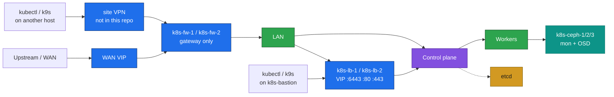
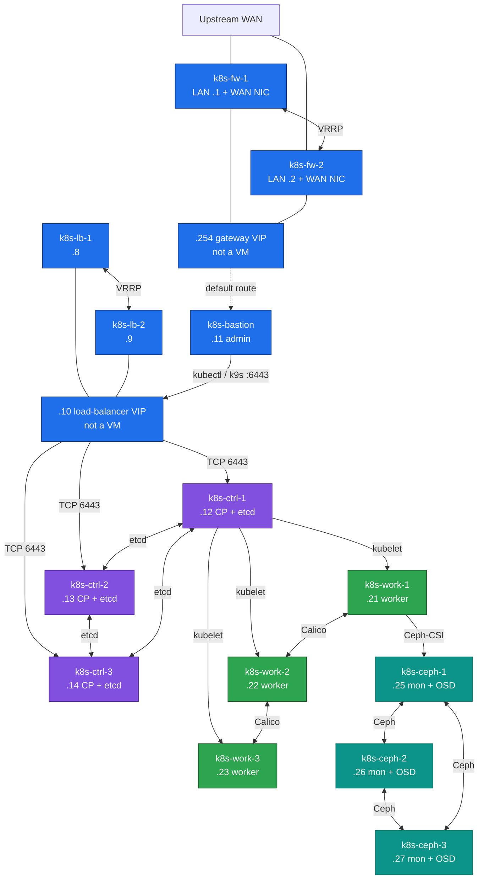

# 01. Inventory and network

**Goal:** VM list, resource budget, and the LAN plan for whichever profile and scenario you are deploying.

## Teaching note

Give each job its own VM. The gateway is not the API load balancer. The bastion is not a Kubernetes node. Ceph is not on the workers, so a busy pod cannot steal CPU from an OSD. Addresses in this file are examples on `10.0.1.0/24`. Pods use `192.168.0.0/16` and services use `10.96.0.0/12`. Those three ranges must not overlap. This lab has 14 VMs on one server for stacked Debian. That is a lot of guests, not a second rack.

> VM creation is out of scope ([00-overview.md](00-overview.md)). These tables are what the VMs look like once they exist.

## One server, four scenarios

The cluster runs on the KVM host below. Plan it as an empty server with **128 GB** of RAM. The 32 GB machine is not a deploy target. Only one cluster is powered on at a time, so the four scenarios do not add together. Debian 13 first, then Ubuntu 26, on that same server, still one at a time.

Guest RAM stays under 128 GB. Stacked keeps etcd inside three 8 GB control planes (24 GB for that tier). External moves etcd onto three 4 GB VMs and keeps two 8 GB apiservers (28 GB for that tier). More machines, more RAM. External plus the GPU worker is the largest, at 126 GB.

## KVM host

One KVM server runs every VM. Measured on that host (Ryzen 9 3900X). Usable RAM is what `free` reports, not the sticker on the modules. Partition sizes are what `lsblk` reports. This table has no OSD disk: Ceph's disks are extra disks on the Ceph VMs.

| Resource            | KVM host                                                      |
| ------------------- | ------------------------------------------------------------- |
| Servers             | 1                                                             |
| CPU                 | AMD Ryzen 9 3900X, 12 cores, 24 threads. AMD-V. Boost is off. |
| RAM                 | 128 GB. Idle host uses about 2 GB. Plan the server as empty.  |
| OS disk             | Samsung 850 EVO 250GB. 32G on `/`, 192G on `/data-root`.      |
| Second disk         | Samsung 970 EVO Plus 250GB. 192G on `/data-root/sssd`.        |
| Third disk          | Samsung 970 EVO Plus 1TB. 888G on `/data-root/lssd`.          |
| Clusters powered on | 1                                                             |

A single host cannot provide redundancy or failover. There is no second server to take over. If this machine loses power, crashes, or a disk fails, every VM stops and the cluster is down. Keepalived does not help in that case, because both members of a pair are on the same host.

The host can still provide fault tolerance for a VM, while the host itself stays up. One firewall VM can die and the other keeps the gateway. One API proxy can die and the other keeps `10.0.1.10`. One control plane or one etcd member can die and the cluster still has quorum. One worker can die and its pods move to the other two. One Ceph VM can die and Ceph still has two OSDs and two monitors. That is tolerance of a guest failure, not failover of the server.

Whoever creates the VMs sets a 50% CPU share on them. That setting is not part of this procedure. Under that share, 2 guest vCPUs count as 1 host CPU, so one scenario stays at or under 44 vCPUs. 44 guest vCPUs are 22 host CPUs. The host is 12 cores and 24 threads. Guest RAM is in GB against the 128 GB above. The idle host uses about 2 GB, so that is the reserve. Guests may use 126 GB.

The 200 GB Ceph disks are on `k8s-ceph-1/2/3` only. Those VMs are not Kubernetes nodes, so pods and Ceph do not share a guest. In this lab all three OSD images still sit on the one 888G SSD. That is accepted. It is not a production disk layout. The workers and the GPU VM have no OSD. Plan `/data-root`, `/data-root/sssd`, and `/data-root/lssd` as empty for this cluster. Do not put VM images on the 32G `/`.

Rollout: [README.md](README.md#rollout-plan).

LAN addresses here are **examples**. Use your own when you provision. Do not commit site WAN or LAN addresses into this repo. Each firewall has a second NIC on WAN; WAN addresses stay off these tables.

## Network

- **Gateway:** `k8s-fw-1` / `k8s-fw-2`, keepalived only, LAN VIP `10.0.1.254`. Every node defaults through this address. No HAProxy here. [03-firewall.md](03-firewall.md).
- **Load balancer:** `k8s-lb-1` / `k8s-lb-2`, keepalived + HAProxy, VIP `10.0.1.10`. Clients use it for the API (`:6443`) and, after ingress, for `:80`/`:443`. Own VRID, different from the firewall LAN VRID. Node-to-node traffic does not pass through this pair. [05-deploy-kubernetes.md](05-deploy-kubernetes.md).
- **Bastion** `10.0.1.11`: jump host, Nexus, Prometheus, Grafana, `kubectl`, k9s, Helm. One VM is normal for this role. No HAProxy and no VIP on it. It is on the LAN, so `kubectl` and k9s talk to `10.0.1.10:6443` directly. [05-deploy-kubernetes.md](05-deploy-kubernetes.md) installs both. k9s is set `logoless: true`.
- **kubectl and k9s from any other host:** same API address, `https://10.0.1.10:6443`, and only after the site VPN is up. That path enters through the firewall pair. The VPN server is outside this repo. Do not publish `:6443` on the WAN, and do not SSH-tunnel the API.
- **DNS:** static `/etc/hosts` on every node ([02-prepare.md](02-prepare.md)). No cluster DNS server for node names.
- **Kubernetes ranges** (must not overlap the LAN): pod CIDR `192.168.0.0/16`, service CIDR `10.96.0.0/12`.
- **Ceph:** `k8s-ceph-1` / `k8s-ceph-2` / `k8s-ceph-3` at `.25` / `.26` / `.27`. Each runs one monitor, one manager, and one OSD. They are not kubelet nodes. Workers reach them for Ceph-CSI. [06-ceph.md](06-ceph.md).
- **Ports:** `6443` (apiserver, via the API VIP), `80`/`443` (ingress, same VIP, added in [07-ingress.md](07-ingress.md)), `8081`/`8082` (Nexus), `2379-2380` (etcd), `3300`/`6789` (Ceph mons), `10250` (kubelet), `179`/`4789` (Calico), `9100` (node_exporter), `9090`/`3000` (Prometheus/Grafana on the bastion). VRRP is protocol 112, once for the firewall pair and once for the API pair.
- First Nexus fill goes out through the firewall NAT. After [04-bastion.md](04-bastion.md), apt and image pulls can use the bastion cache.

The bastion is an admin client of the API VIP. It is not a hop on the gateway path or the ingress path. Another host's `kubectl` or k9s is drawn through the site VPN and the firewall, then the LAN, then the API VIP.

### VMs and connections — stacked

Fourteen VMs in the stacked scenario. Addresses are the example LAN. External etcd drops `k8s-ctrl-3` and adds `k8s-etcd-1/2/3` (`.15`–`.17`). GPU adds `k8s-work-4` (`.24`). Ceph is `k8s-ceph-1/2/3` (`.25`–`.27`) in every scenario.

Every box except the two VIPs is a VM. Both firewalls have a WAN NIC and a LAN NIC. Every other VM has one LAN NIC on `10.0.1.0/24` and uses `.254` as its default gateway. `k8s-bastion` is on that LAN for SSH, Nexus, metrics, and `kubectl` / k9s to `.10:6443`. It is not a proxy in front of the API. A host that is not one of these VMs reaches that same API address only through the site VPN, which enters at `k8s-fw-1` / `k8s-fw-2`. After ingress, `.10` also accepts TCP 80 and 443 and HAProxy sends those to the workers.

## VM resources

One row per VM type. The scenario tables below repeat these sizes with names and example addresses.

| VM                                   | vCPU   | RAM         | Root  | Ceph OSD | Where it appears                                           |
| ------------------------------------ | ------ | ----------- | ----- | -------- | ---------------------------------------------------------- |
| k8s-fw-1, k8s-fw-2                   | 2      | 2 GB        | 20 GB | —        | All four scenarios                                         |
| k8s-lb-1, k8s-lb-2                   | 1      | 1 GB        | 10 GB | —        | All four scenarios                                         |
| k8s-bastion                          | 2 or 4 | 4 GB        | 40 GB | —        | 4 vCPU only in scenario 1                                  |
| k8s-ctrl (stacked, etcd on the node) | 4      | 8 GB        | 30 GB | —        | Scenarios 1 and 2, three nodes                             |
| k8s-ctrl (external, no etcd)         | 4      | 8 GB        | 30 GB | —        | Scenarios 3 and 4, two nodes                               |
| k8s-etcd                             | 2      | 4 GB        | 20 GB | —        | Scenarios 3 and 4, three nodes                             |
| k8s-work-1/2/3                       | 4      | 16 or 20 GB | 20 GB | —        | 20 GB in scenarios 1 and 3. 16 GB in 2 and 4. No OSD.      |
| k8s-ceph-1/2/3                       | 2      | 8 GB        | 20 GB | 200 GB   | All four scenarios. Not a Kubernetes node.                 |
| k8s-work-4 (GPU)                     | 2 or 4 | 12 or 16 GB | 20 GB | —        | 12 GB in scenario 2, 16 GB in scenario 4. Not a Ceph node. |

Scenario totals. Only one row is powered on at a time. vCPU stays at or under 42 (95% of 44). RAM may use all but 2 GB of the 128 GB, because that is what the idle host uses. The full VM list for each scenario follows.

| Scenario               | VMs | vCPU | Guest RAM | Of 44 vCPUs | Of 128 GB | Root   | Ceph OSD |
| ---------------------- | --- | ---- | --------- | ----------- | --------- | ------ | -------- |
| 1. Stacked             | 14  | 40   | 118 GB    | 91%         | 92%       | 310 GB | 600 GB   |
| 2. Stacked + GPU       | 15  | 42   | 118 GB    | 95%         | 92%       | 330 GB | 600 GB   |
| 3. External etcd       | 16  | 40   | 122 GB    | 91%         | 95%       | 340 GB | 600 GB   |
| 4. External etcd + GPU | 17  | 42   | 126 GB    | 95%         | 98%       | 360 GB | 600 GB   |

## Where each scenario lands

VM root disks are image files on the two 192G volumes together (`/data-root` and `/data-root/sssd`, 384G). Do not put them on the 32G `/`. The three 200 GB Ceph disks are image files on the 888G volume (`/data-root/lssd`). The GPU VM has no Ceph disk. Only one scenario is on disk at a time.

| Scenario               | vCPU of 44 | RAM of 128 GB      | Root disks on 384G | Ceph disks on 888G |
| ---------------------- | ---------- | ------------------ | ------------------ | ------------------ |
| 1. Stacked             | 40, 91%    | 118 GB, 10 GB left | 310 GB, fits       | 600 GB, fits       |
| 2. Stacked + GPU       | 42, 95%    | 118 GB, 10 GB left | 330 GB, fits       | 600 GB, fits       |
| 3. External etcd       | 40, 91%    | 122 GB, 6 GB left  | 340 GB, fits       | 600 GB, fits       |
| 4. External etcd + GPU | 42, 95%    | 126 GB, 2 GB left  | 360 GB, fits       | 600 GB, fits       |

The 50% share is set on the VM by the person who creates it. Scenario 4 leaves 2 GB, which matches the idle host. The GPU VM there is 2 vCPUs and 16 GB, and the workers are 16 GB. The three Ceph images share the 888G SSD on purpose. Putting root disks and Ceph disks on that same SSD together does not fit: the smallest sum is 910G against 888G. That is why the root disks stay on the two 192G volumes.

## 1. Stacked etcd

| #   | VM Name                | Role                                                 | LAN IP (example) | vCPU   | RAM        | Root Disk  | Ceph OSD   |
| --- | ---------------------- | ---------------------------------------------------- | ---------------- | ------ | ---------- | ---------- | ---------- |
| 01  | k8s-fw-1               | Firewall (WAN + LAN)                                 | 10.0.1.1         | 2      | 2 GB       | 20 GB      | -          |
| 02  | k8s-fw-2               | Firewall (WAN + LAN)                                 | 10.0.1.2         | 2      | 2 GB       | 20 GB      | -          |
| 03  | k8s-lb-1               | API HAProxy (VRRP master)                            | 10.0.1.8         | 1      | 1 GB       | 10 GB      | -          |
| 04  | k8s-lb-2               | API HAProxy (VRRP backup)                            | 10.0.1.9         | 1      | 1 GB       | 10 GB      | -          |
| 05  | k8s-bastion            | Jump / kubectl + k9s + Helm / Nexus / Prom / Grafana | 10.0.1.11        | 4      | 4 GB       | 40 GB      | -          |
| 06  | k8s-ctrl-1             | Control Plane + etcd                                 | 10.0.1.12        | 4      | 8 GB       | 30 GB      | -          |
| 07  | k8s-ctrl-2             | Control Plane + etcd                                 | 10.0.1.13        | 4      | 8 GB       | 30 GB      | -          |
| 08  | k8s-ctrl-3             | Control Plane + etcd                                 | 10.0.1.14        | 4      | 8 GB       | 30 GB      | -          |
| 09  | k8s-work-1             | Worker                                               | 10.0.1.21        | 4      | 20 GB      | 20 GB      | -          |
| 10  | k8s-work-2             | Worker                                               | 10.0.1.22        | 4      | 20 GB      | 20 GB      | -          |
| 11  | k8s-work-3             | Worker                                               | 10.0.1.23        | 4      | 20 GB      | 20 GB      | -          |
| 12  | k8s-ceph-1             | Ceph mon + mgr + OSD                                 | 10.0.1.25        | 2      | 8 GB       | 20 GB      | 200 GB     |
| 13  | k8s-ceph-2             | Ceph mon + mgr + OSD                                 | 10.0.1.26        | 2      | 8 GB       | 20 GB      | 200 GB     |
| 14  | k8s-ceph-3             | Ceph mon + mgr + OSD                                 | 10.0.1.27        | 2      | 8 GB       | 20 GB      | 200 GB     |
|     | **VM TOTALS (14 VMs)** |                                                      |                  | **40** | **118 GB** | **310 GB** | **600 GB** |

40 vCPUs is 91% of 44. 118 GB is 92% of 128 GB, so 10 GB stays with the host. The workers are containers only. Ceph has its own three VMs. No HAProxy on the bastion. Its 40 GB disk is the Nexus blob store. Gateway VIP `10.0.1.254` and API VIP `10.0.1.10` are not VMs.

## 2. Stacked etcd + GPU

Workers are 16 GB here, not 20 GB, so the GPU VM fits inside 95% of the host. `k8s-work-4` has no Ceph disk.

| #   | VM Name                | Role                                                 | LAN IP (example) | vCPU   | RAM        | Root Disk  | Ceph OSD   |
| --- | ---------------------- | ---------------------------------------------------- | ---------------- | ------ | ---------- | ---------- | ---------- |
| 01  | k8s-fw-1               | Firewall (WAN + LAN)                                 | 10.0.1.1         | 2      | 2 GB       | 20 GB      | -          |
| 02  | k8s-fw-2               | Firewall (WAN + LAN)                                 | 10.0.1.2         | 2      | 2 GB       | 20 GB      | -          |
| 03  | k8s-lb-1               | API HAProxy (VRRP master)                            | 10.0.1.8         | 1      | 1 GB       | 10 GB      | -          |
| 04  | k8s-lb-2               | API HAProxy (VRRP backup)                            | 10.0.1.9         | 1      | 1 GB       | 10 GB      | -          |
| 05  | k8s-bastion            | Jump / kubectl + k9s + Helm / Nexus / Prom / Grafana | 10.0.1.11        | 2      | 4 GB       | 40 GB      | -          |
| 06  | k8s-ctrl-1             | Control Plane + etcd                                 | 10.0.1.12        | 4      | 8 GB       | 30 GB      | -          |
| 07  | k8s-ctrl-2             | Control Plane + etcd                                 | 10.0.1.13        | 4      | 8 GB       | 30 GB      | -          |
| 08  | k8s-ctrl-3             | Control Plane + etcd                                 | 10.0.1.14        | 4      | 8 GB       | 30 GB      | -          |
| 09  | k8s-work-1             | Worker                                               | 10.0.1.21        | 4      | 16 GB      | 20 GB      | -          |
| 10  | k8s-work-2             | Worker                                               | 10.0.1.22        | 4      | 16 GB      | 20 GB      | -          |
| 11  | k8s-work-3             | Worker                                               | 10.0.1.23        | 4      | 16 GB      | 20 GB      | -          |
| 12  | k8s-ceph-1             | Ceph mon + mgr + OSD                                 | 10.0.1.25        | 2      | 8 GB       | 20 GB      | 200 GB     |
| 13  | k8s-ceph-2             | Ceph mon + mgr + OSD                                 | 10.0.1.26        | 2      | 8 GB       | 20 GB      | 200 GB     |
| 14  | k8s-ceph-3             | Ceph mon + mgr + OSD                                 | 10.0.1.27        | 2      | 8 GB       | 20 GB      | 200 GB     |
| 15  | k8s-work-4             | Worker / GPU                                         | 10.0.1.24        | 4      | 12 GB      | 20 GB      | —          |
|     | **VM TOTALS (15 VMs)** |                                                      |                  | **42** | **118 GB** | **330 GB** | **600 GB** |

42 vCPUs is 95% of 44. 118 GB is 92% of 128 GB. Driver and device plugin: [14-gpu.md](14-gpu.md).

## 3. External etcd

Control plane drops to 2 nodes. etcd moves to 3 smaller VMs. Apiserver is stateless; only etcd needs an odd count ([00-overview.md](00-overview.md#scenarios)).

| #   | VM Name                | Role                                                 | LAN IP (example) | vCPU   | RAM        | Root Disk  | Ceph OSD   |
| --- | ---------------------- | ---------------------------------------------------- | ---------------- | ------ | ---------- | ---------- | ---------- |
| 01  | k8s-fw-1               | Firewall (WAN + LAN)                                 | 10.0.1.1         | 2      | 2 GB       | 20 GB      | -          |
| 02  | k8s-fw-2               | Firewall (WAN + LAN)                                 | 10.0.1.2         | 2      | 2 GB       | 20 GB      | -          |
| 03  | k8s-lb-1               | API HAProxy (VRRP master)                            | 10.0.1.8         | 1      | 1 GB       | 10 GB      | -          |
| 04  | k8s-lb-2               | API HAProxy (VRRP backup)                            | 10.0.1.9         | 1      | 1 GB       | 10 GB      | -          |
| 05  | k8s-bastion            | Jump / kubectl + k9s + Helm / Nexus / Prom / Grafana | 10.0.1.11        | 2      | 4 GB       | 40 GB      | -          |
| 06  | k8s-ctrl-1             | Control Plane                                        | 10.0.1.12        | 4      | 8 GB       | 30 GB      | -          |
| 07  | k8s-ctrl-2             | Control Plane                                        | 10.0.1.13        | 4      | 8 GB       | 30 GB      | -          |
| 08  | k8s-etcd-1             | etcd                                                 | 10.0.1.15        | 2      | 4 GB       | 20 GB      | -          |
| 09  | k8s-etcd-2             | etcd                                                 | 10.0.1.16        | 2      | 4 GB       | 20 GB      | -          |
| 10  | k8s-etcd-3             | etcd                                                 | 10.0.1.17        | 2      | 4 GB       | 20 GB      | -          |
| 11  | k8s-work-1             | Worker                                               | 10.0.1.21        | 4      | 20 GB      | 20 GB      | -          |
| 12  | k8s-work-2             | Worker                                               | 10.0.1.22        | 4      | 20 GB      | 20 GB      | -          |
| 13  | k8s-work-3             | Worker                                               | 10.0.1.23        | 4      | 20 GB      | 20 GB      | -          |
| 14  | k8s-ceph-1             | Ceph mon + mgr + OSD                                 | 10.0.1.25        | 2      | 8 GB       | 20 GB      | 200 GB     |
| 15  | k8s-ceph-2             | Ceph mon + mgr + OSD                                 | 10.0.1.26        | 2      | 8 GB       | 20 GB      | 200 GB     |
| 16  | k8s-ceph-3             | Ceph mon + mgr + OSD                                 | 10.0.1.27        | 2      | 8 GB       | 20 GB      | 200 GB     |
|     | **VM TOTALS (16 VMs)** |                                                      |                  | **40** | **122 GB** | **340 GB** | **600 GB** |

40 vCPUs is 91% of 44. 122 GB is 95% of 128 GB. The etcd tier is 2 × 8 GB plus 3 × 4 GB = 28 GB, against 24 GB for the three stacked control planes. More machines, more RAM, and still inside the ceiling.

## 4. External etcd + GPU

Workers are 16 GB instead of 20 GB, so this row can keep a 16 GB GPU VM and still leave 2 GB on the host. The GPU VM is 2 vCPUs. It does not join Ceph.

| #   | VM Name                | Role                                                 | LAN IP (example) | vCPU   | RAM        | Root Disk  | Ceph OSD   |
| --- | ---------------------- | ---------------------------------------------------- | ---------------- | ------ | ---------- | ---------- | ---------- |
| 01  | k8s-fw-1               | Firewall (WAN + LAN)                                 | 10.0.1.1         | 2      | 2 GB       | 20 GB      | -          |
| 02  | k8s-fw-2               | Firewall (WAN + LAN)                                 | 10.0.1.2         | 2      | 2 GB       | 20 GB      | -          |
| 03  | k8s-lb-1               | API HAProxy (VRRP master)                            | 10.0.1.8         | 1      | 1 GB       | 10 GB      | -          |
| 04  | k8s-lb-2               | API HAProxy (VRRP backup)                            | 10.0.1.9         | 1      | 1 GB       | 10 GB      | -          |
| 05  | k8s-bastion            | Jump / kubectl + k9s + Helm / Nexus / Prom / Grafana | 10.0.1.11        | 2      | 4 GB       | 40 GB      | -          |
| 06  | k8s-ctrl-1             | Control Plane                                        | 10.0.1.12        | 4      | 8 GB       | 30 GB      | -          |
| 07  | k8s-ctrl-2             | Control Plane                                        | 10.0.1.13        | 4      | 8 GB       | 30 GB      | -          |
| 08  | k8s-etcd-1             | etcd                                                 | 10.0.1.15        | 2      | 4 GB       | 20 GB      | -          |
| 09  | k8s-etcd-2             | etcd                                                 | 10.0.1.16        | 2      | 4 GB       | 20 GB      | -          |
| 10  | k8s-etcd-3             | etcd                                                 | 10.0.1.17        | 2      | 4 GB       | 20 GB      | -          |
| 11  | k8s-work-1             | Worker                                               | 10.0.1.21        | 4      | 16 GB      | 20 GB      | -          |
| 12  | k8s-work-2             | Worker                                               | 10.0.1.22        | 4      | 16 GB      | 20 GB      | -          |
| 13  | k8s-work-3             | Worker                                               | 10.0.1.23        | 4      | 16 GB      | 20 GB      | -          |
| 14  | k8s-ceph-1             | Ceph mon + mgr + OSD                                 | 10.0.1.25        | 2      | 8 GB       | 20 GB      | 200 GB     |
| 15  | k8s-ceph-2             | Ceph mon + mgr + OSD                                 | 10.0.1.26        | 2      | 8 GB       | 20 GB      | 200 GB     |
| 16  | k8s-ceph-3             | Ceph mon + mgr + OSD                                 | 10.0.1.27        | 2      | 8 GB       | 20 GB      | 200 GB     |
| 17  | k8s-work-4             | Worker / GPU                                         | 10.0.1.24        | 2      | 16 GB      | 20 GB      | —          |
|     | **VM TOTALS (17 VMs)** |                                                      |                  | **42** | **126 GB** | **360 GB** | **600 GB** |

42 vCPUs is 95% of 44. 126 GB leaves 2 GB of the 128 GB. That matches the idle host, which uses about 2 GB with no VMs running.

## Prerequisites
- [00-overview.md](00-overview.md)

## Next
- [02-prepare.md](02-prepare.md)
