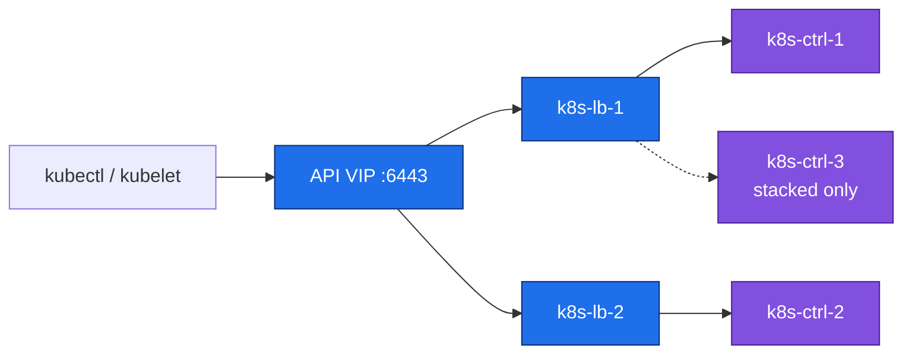
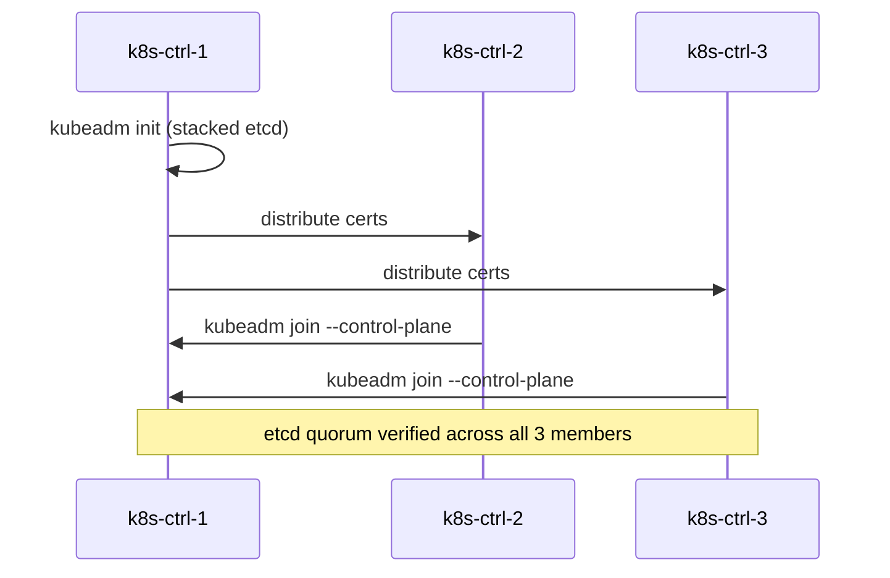
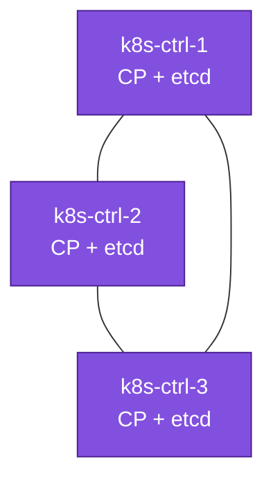
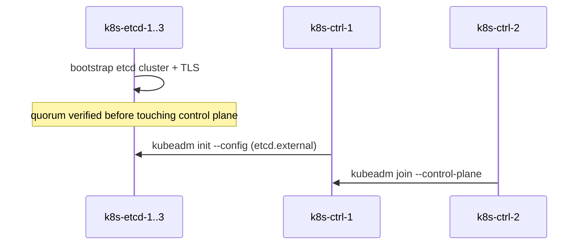
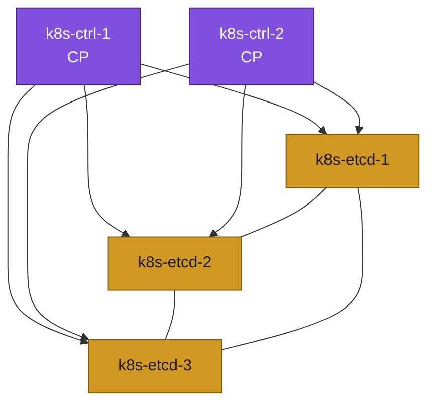
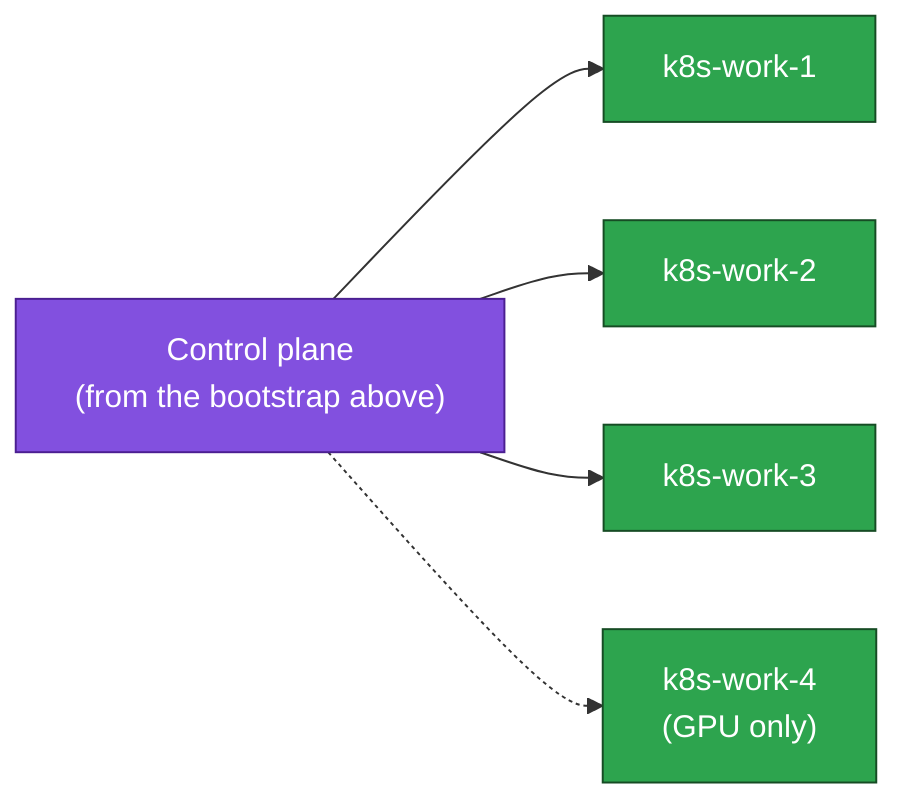

# 05. Deploy Kubernetes

**Goal:** Container runtime on the Kubernetes nodes, a two-node API load balancer, then one control-plane bootstrap (stacked **or** external), worker join, and Calico. `kubectl`, k9s, and Helm land on the bastion at the end of the bootstrap you opened.

## Teaching note

kubeadm needs a stable API address before the first `init`. That address is the HAProxy VIP, not a node's own IP. Three control planes share etcd in the stacked path. If one node dies, you lose both an API server and an etcd member. That is why three is the minimum. containerd must be 2.x for Kubernetes 1.36. Pin kubelet, kubeadm, and kubectl to the same string, then hold them. Calico is one minor behind so file 11 has a real upgrade. The lab limit is still one host.

Open **one** bootstrap section. Stacked is the current pass.

## Container runtime

**Goal:** Install and configure the container runtime on control-plane and worker nodes.

## Applies to
Every `k8s-ctrl-*` and `k8s-work-*` in the inventory table you circled in [01-inventory.md](01-inventory.md). Not required on the firewalls, the API load-balancer pair, the bastion, or `k8s-etcd-*`.

## Steps

**1. Install pinned containerd 2.x** — Kubernetes 1.36 does not support containerd 1.x ([SIG Node](https://kubernetes.io/blog/2025/09/12/kubernetes-v1-34-cri-cgroup-driver-lookup-now-ga/)). Debian 13's `containerd` package is 1.7 and is too old. Use Docker's `containerd.io` on cluster nodes. Do **not** install `docker-ce` here. Docker Engine stays on the bastion only.
```sh
sudo apt update
sudo apt install -y ca-certificates curl
sudo install -m 0755 -d /etc/apt/keyrings
cat /etc/apt/sources.list.d/docker.sources 2>/dev/null || true
sudo curl -fsSL https://download.docker.com/linux/debian/gpg -o /etc/apt/keyrings/docker.asc
sudo chmod a+r /etc/apt/keyrings/docker.asc
sudo tee /etc/apt/sources.list.d/docker.sources <<EOF
Types: deb
URIs: https://download.docker.com/linux/debian
Suites: $(. /etc/os-release && echo "$VERSION_CODENAME")
Components: stable
Architectures: $(dpkg --print-architecture)
Signed-By: /etc/apt/keyrings/docker.asc
EOF
cat /etc/apt/sources.list.d/docker.sources
sudo apt update
apt-cache madison containerd.io
# Kubernetes 1.36 needs 2.2.0+ or 2.3.0+. Kubernetes 1.37 needs 2.3.0+ or 2.4.0+.
# Do not pick 2.1.x. Prefer 2.3.x LTS or 2.4.x so file 11 does not have to jump the runtime.
CONTAINERD_VERSION="<2.3.x or 2.4.x from madison>"
sudo apt install -y containerd.io=${CONTAINERD_VERSION}
sudo apt-mark hold containerd.io                                      # apt upgrade must not move the runtime
containerd --version                                                  # 2.3 or 2.4, not 2.1
```
On Ubuntu 26, the URI host is `https://download.docker.com/linux/ubuntu` and the suite is that distro's codename. Same pin-and-hold.

**2. systemd cgroup driver** — kubelet uses systemd, so containerd must too. Read any file already on disk, write `/etc/containerd/config.toml`, then restart so the running daemon loads it. Apt has usually started containerd already; `enable --now` does not reload it. No registry mirror is installed in this manual. If you add one later, it is another file under that config, written before this restart. See [04-bastion.md](04-bastion.md).
```sh
sudo mkdir -p /etc/containerd
grep -n SystemdCgroup /etc/containerd/config.toml 2>/dev/null || true  # read before replace
containerd config default | sudo tee /etc/containerd/config.toml       # package default can disable CRI
grep -n SystemdCgroup /etc/containerd/config.toml
sudo sed -i 's/SystemdCgroup = false/SystemdCgroup = true/' /etc/containerd/config.toml
grep -n SystemdCgroup /etc/containerd/config.toml                      # the file is what survives reboot
sudo systemctl enable --now containerd
sudo systemctl restart containerd                                     # the daemon reads that file
sudo ctr version                                                       # client can talk to the daemon
ls -l /run/containerd/containerd.sock                                  # kubeadm uses this socket
```


## API load balancer

**Goal:** Two HAProxy nodes with keepalived, so the apiserver address survives one of them dying. Same VRRP pattern as the firewalls, own VRID. This pair is the only place HAProxy runs. The firewall stays a gateway. The bastion stays an admin VM. Neither owns `10.0.1.10`. Ingress later adds `:80` and `:443` on this same VIP.

**Applies to:** `k8s-lb-1` and `k8s-lb-2` only. One LAN NIC each. No kubelet, no containerd, no Docker.

```sh
LAN_IF=eth0              # NIC on 10.0.1.0/24
API_VIP=10.0.1.10
API_VRID=61              # must differ from the firewall LAN VRID; same L2, or the gateway and the API fight
```

`k8s-lb-1` is MASTER (priority 100). `k8s-lb-2` is BACKUP (priority 90). Same `API_VRID` on both.

**1. Bind the VIP before this node owns it.** Without this, the backup's HAProxy cannot start until keepalived moves the address. Read the value, write the boot file, then load that file.
```sh
sysctl -n net.ipv4.ip_nonlocal_bind
printf 'net.ipv4.ip_nonlocal_bind = 1\n' | sudo tee /etc/sysctl.d/k8s-lb.conf   # survives reboot
sudo sysctl --system                                                            # apply the file
sysctl -n net.ipv4.ip_nonlocal_bind                                             # must print 1
```

**2. Pinned keepalived and HAProxy** (same versions on both nodes):

```sh
sudo apt update
apt-cache madison keepalived haproxy
KEEPALIVED_VERSION="<version from madison>"
HAPROXY_VERSION="<version from madison>"
sudo apt install -y keepalived=${KEEPALIVED_VERSION} haproxy=${HAPROXY_VERSION}
sudo apt-mark hold keepalived haproxy
```

**3. keepalived** — both nodes. Read the package sample, replace `/etc/keepalived/keepalived.conf`, test it, then restart. `k8s-lb-1` is MASTER / priority 100. `k8s-lb-2` is BACKUP / priority 90. `auth_pass` is local only (8 characters; keepalived truncates). Do not commit it. `API_VRID` must differ from the firewall LAN VRID.
```sh
LAN_IF=eth0                                         # NIC on 10.0.1.0/24
API_VRID=61                                         # must differ from the firewall LAN VRID
STATE=MASTER                                        # BACKUP on k8s-lb-2
PRIORITY=100                                        # 90 on k8s-lb-2
AUTH_PASS="<8 characters, local only>"
sudo grep -n . /etc/keepalived/keepalived.conf || true
sudo tee /etc/keepalived/keepalived.conf <<EOF
vrrp_instance API {
    state ${STATE}
    interface ${LAN_IF}
    virtual_router_id ${API_VRID}
    priority ${PRIORITY}
    advert_int 1
    authentication {
        auth_type PASS
        auth_pass ${AUTH_PASS}
    }
    virtual_ipaddress {
        10.0.1.10/24
    }
}
EOF
sudo keepalived -t                                  # exit 0, or do not start it
sudo systemctl enable --now keepalived
sudo systemctl restart keepalived                   # the running process reads the file
ip -br addr show                                    # MASTER shows 10.0.1.10; BACKUP does not
```

**4. HAProxy** — same file on both nodes. Read the package `/etc/haproxy/haproxy.cfg` first. If it has a sample `bind *:80`, comment that frontend and its backend in the file: `*:80` already covers the VIP, and [07-ingress.md](07-ingress.md) binds `10.0.1.10:80` later. Keep the package `global` and `defaults`. Append one frontend. The `timeout` lines are longer than a typical package default so an API watch is not cut at 50 seconds. Skip the append if `k8s-apiserver` is already in the file. `ip_nonlocal_bind` is why the backup can bind an address it does not hold.

Stacked etcd — three apiserver backends:
```sh
grep -n -E 'bind |^frontend|^backend' /etc/haproxy/haproxy.cfg
sudo tee -a /etc/haproxy/haproxy.cfg <<'EOF'

frontend k8s-apiserver
    bind 10.0.1.10:6443
    mode tcp
    option tcplog
    timeout client 1h
    default_backend k8s-apiserver-backend

backend k8s-apiserver-backend
    mode tcp
    option tcp-check
    balance roundrobin
    timeout server 1h
    timeout check 5s
    server k8s-ctrl-1 10.0.1.12:6443 check fall 3 rise 2
    server k8s-ctrl-2 10.0.1.13:6443 check fall 3 rise 2
    server k8s-ctrl-3 10.0.1.14:6443 check fall 3 rise 2
EOF
sudo haproxy -c -f /etc/haproxy/haproxy.cfg          # stop if this fails
sudo systemctl enable --now haproxy
sudo systemctl restart haproxy                      # the process reads the file
nc -zv 10.0.1.10 6443
```

External etcd — same file, two backends, no `k8s-ctrl-3`. Run this instead of the stacked append:
```sh
grep -n -E 'bind |^frontend|^backend' /etc/haproxy/haproxy.cfg
sudo tee -a /etc/haproxy/haproxy.cfg <<'EOF'

frontend k8s-apiserver
    bind 10.0.1.10:6443
    mode tcp
    option tcplog
    timeout client 1h
    default_backend k8s-apiserver-backend

backend k8s-apiserver-backend
    mode tcp
    option tcp-check
    balance roundrobin
    timeout server 1h
    timeout check 5s
    server k8s-ctrl-1 10.0.1.12:6443 check fall 3 rise 2
    server k8s-ctrl-2 10.0.1.13:6443 check fall 3 rise 2
EOF
sudo haproxy -c -f /etc/haproxy/haproxy.cfg
sudo systemctl enable --now haproxy
sudo systemctl restart haproxy
nc -zv 10.0.1.10 6443
```

`nc -zv` should succeed: HAProxy is listening on the VIP while every backend is still down. Connection refused means keepalived does not hold `.10` on either node, or HAProxy did not start. Backend servers show `DOWN` until the apiservers exist. That is expected. The bastion reaches this VIP on the LAN. Any other host reaches it only through the site VPN and the firewall pair. That VPN server is not part of this repo.

Failover: `sudo systemctl stop keepalived` on MASTER. `.10` appears on BACKUP within a couple of seconds and `nc` still succeeds. Start keepalived on MASTER again afterward.




## Bootstrap — stacked etcd

Open this section only for **Scenario A**.

**Goal:** Initialize the HA control plane with `kubeadm`, etcd stacked on each control-plane node.

Open this file only if you circled **Scenario A (stacked etcd)** in [01-inventory.md](01-inventory.md). External etcd: [05-deploy-kubernetes.md](05-deploy-kubernetes.md).

## Steps

**1. Kubernetes packages on every control plane** — one minor behind current stable, same pin on all three. The later upgrade needs that gap.
```sh
KUBE_DEPLOY_MINOR=v1.36   # one behind current stable; recheck kubernetes.io/releases
sudo mkdir -p /etc/apt/keyrings
curl -fsSL "https://pkgs.k8s.io/core:/stable:/${KUBE_DEPLOY_MINOR}/deb/Release.key" \
  | sudo gpg --dearmor -o /etc/apt/keyrings/kubernetes-apt-keyring.gpg   # pkgs.k8s.io signing key
cat /etc/apt/sources.list.d/kubernetes.list 2>/dev/null || true   # read before replace
echo "deb [signed-by=/etc/apt/keyrings/kubernetes-apt-keyring.gpg] https://pkgs.k8s.io/core:/stable:/${KUBE_DEPLOY_MINOR}/deb/ /" \
  | sudo tee /etc/apt/sources.list.d/kubernetes.list
cat /etc/apt/sources.list.d/kubernetes.list                       # apt reads this file
sudo apt update
apt-cache madison kubeadm                                    # copy the exact package string
KUBE_DEPLOY_VERSION="1.36.5-1.1"                             # must match madison, including the -1.1 suffix
sudo apt install -y kubelet=${KUBE_DEPLOY_VERSION} kubeadm=${KUBE_DEPLOY_VERSION} kubectl=${KUBE_DEPLOY_VERSION}
sudo apt-mark hold kubelet kubeadm kubectl                   # apt upgrade must not move these
sudo systemctl enable kubelet                                # kubeadm starts it; do not start it yet
```
Use the **same** `KUBE_DEPLOY_VERSION` on all three control-plane nodes — a version mismatch between them is exactly the kind of thing this pinning is meant to prevent.

**2. `kubeadm init` on `k8s-ctrl-1` only** — the endpoint is the API VIP, not this node's own IP. Save both join commands it prints.
```sh
sudo kubeadm init \
  --control-plane-endpoint "10.0.1.10:6443" \                  # HAProxy VIP
  --upload-certs \                                             # other control planes can join for 2 hours
  --pod-network-cidr "192.168.0.0/16" \                        # must match Calico later
  --kubernetes-version "v${KUBE_DEPLOY_VERSION%%-*}"           # same version as the packages
mkdir -p $HOME/.kube
sudo cp -i /etc/kubernetes/admin.conf $HOME/.kube/config       # admin kubeconfig for this user
sudo chown $(id -u):$(id -g) $HOME/.kube/config
```

**3. Join the other control planes** — paste the `--control-plane` command from step 2. The certificate key lasts 2 hours. Regenerate it on `k8s-ctrl-1` with `sudo kubeadm init phase upload-certs --upload-certs` if it expired.
```sh
sudo kubeadm join 10.0.1.10:6443 --token <token> \
  --discovery-token-ca-cert-hash sha256:<hash> \
  --control-plane --certificate-key <key>          # makes this node a control plane, not a worker
```

**4. Check etcd** — from `k8s-ctrl-1`. Do not use `sudo kubectl`; that looks at root's empty kubeconfig.
```sh
kubectl --kubeconfig $HOME/.kube/config -n kube-system exec etcd-k8s-ctrl-1 -- etcdctl \
  --endpoints=https://127.0.0.1:2379 \
  --cacert=/etc/kubernetes/pki/etcd/ca.crt \
  --cert=/etc/kubernetes/pki/etcd/server.crt \
  --key=/etc/kubernetes/pki/etcd/server.key \
  member list                                          # expect 3 members, all started
```
Same thing as `sudo kubectl --kubeconfig /etc/kubernetes/admin.conf ...`. Expect 3 members, all `started`. Nodes stay `NotReady` until the Calico section below — expected at this point.

**5. `kubectl`, k9s, and Helm on the bastion** — admin host only. Do not install `kubelet` or `kubeadm` here. Debian's package named `helm` is Emacs, so Helm 3 comes from the upstream tarball (`v3.22.0`; Helm 4 exists, this lab stays on 3). k9s is the same kind of install: a pinned GitHub tarball, not a distro package.
```sh
KUBE_DEPLOY_MINOR=v1.36            # same minor as step 1
KUBE_DEPLOY_VERSION="1.36.5-1.1"   # same pin as step 1
sudo mkdir -p /etc/apt/keyrings
curl -fsSL "https://pkgs.k8s.io/core:/stable:/${KUBE_DEPLOY_MINOR}/deb/Release.key" \
  | sudo gpg --dearmor -o /etc/apt/keyrings/kubernetes-apt-keyring.gpg
cat /etc/apt/sources.list.d/kubernetes.list 2>/dev/null || true   # read before replace
echo "deb [signed-by=/etc/apt/keyrings/kubernetes-apt-keyring.gpg] https://pkgs.k8s.io/core:/stable:/${KUBE_DEPLOY_MINOR}/deb/ /" \
  | sudo tee /etc/apt/sources.list.d/kubernetes.list
cat /etc/apt/sources.list.d/kubernetes.list                       # apt reads this file
sudo apt update
sudo apt install -y kubectl=${KUBE_DEPLOY_VERSION}          # kubectl only
sudo apt-mark hold kubectl
HELM_VERSION="v3.22.0"                                       # recheck github.com/helm/helm/releases
curl -fsSL "https://get.helm.sh/helm-${HELM_VERSION}-linux-amd64.tar.gz" -o /tmp/helm.tgz
tar -xzf /tmp/helm.tgz -C /tmp
sudo install -m 0755 /tmp/linux-amd64/helm /usr/local/bin/helm
helm version
K9S_VERSION=v0.51.0                                      # recheck github.com/derailed/k9s/releases
curl -fsSL "https://github.com/derailed/k9s/releases/download/${K9S_VERSION}/k9s_Linux_amd64.tar.gz" -o /tmp/k9s.tgz
tar -tzf /tmp/k9s.tgz                                    # the archive contains the k9s binary
tar -xzf /tmp/k9s.tgz -C /tmp
sudo install -m 0755 /tmp/k9s /usr/local/bin/k9s
k9s version
K9S_CFG="${XDG_CONFIG_HOME:-$HOME/.config}/k9s/config.yaml"
mkdir -p "$(dirname "$K9S_CFG")"
if [ -f "$K9S_CFG" ]; then
  grep -n logoless "$K9S_CFG" || true                  # read before changing the existing file
  grep -q 'logoless:' "$K9S_CFG" && sed -i 's/logoless: false/logoless: true/' "$K9S_CFG"
else
  cat > "$K9S_CFG" <<'EOF'
k9s:
  refreshRate: 2
  ui:
    logoless: true
  thresholds:
    cpu:
      critical: 90
      warn: 70
    memory:
      critical: 90
      warn: 70
EOF
fi
grep -n logoless "$K9S_CFG"                            # true; k9s reads this file on start
```
`logoless: true` hides the k9s name in the top bar. The bar itself stays. `k9s --logoless` does that for one run only, so it is not the change. If the file already existed and `grep` showed no `logoless` line, add `logoless: true` under its `ui:` block and grep again. `thresholds` is in the new file because k9s has crashed on a config that omitted it.

**6. Configure `kubectl` on the bastion** — install was step 5. The bastion has no SSH key to `k8s-ctrl-1`, so the workstation copies the kubeconfig. The bastion is on the LAN, so `server` stays `https://10.0.1.10:6443`. It does not use the VPN. k9s uses this same file.
```sh
scp <user>@<k8s-ctrl-1-ip>:.kube/config /tmp/k8s-admin.conf          # from the workstation
ssh <user>@<k8s-bastion-ip> 'mkdir -p ~/.kube && chmod 700 ~/.kube'
scp /tmp/k8s-admin.conf <user>@<k8s-bastion-ip>:.kube/config
rm -f /tmp/k8s-admin.conf
```
```sh
# on k8s-bastion
ls -l ~/.kube/config
chmod 600 ~/.kube/config
kubectl config view --minify -o jsonpath='{.clusters[0].cluster.server}'; echo   # https://10.0.1.10:6443
kubectl get nodes                                                                # NotReady until Calico
```
`k9s` with no arguments reads that kubeconfig. The top bar stays, without the k9s logo.

If the bastion can already SSH to `k8s-ctrl-1`, `scp k8s-ctrl-1:.kube/config ~/.kube/config` there replaces the workstation hop.

**7. `kubectl` and k9s on any other host** — same clients, same kubeconfig, same `server: https://10.0.1.10:6443`. This host is not on the cluster LAN. Its path to that address is the site VPN, and the VPN enters through the firewall pair. The VPN server is outside this repo. Do not publish `:6443` on the WAN VIP. Do not SSH-forward the API and do not change `server` to `127.0.0.1`.
```sh
kubectl config view --minify -o jsonpath='{.clusters[0].cluster.server}'; echo   # still https://10.0.1.10:6443
ip route get 10.0.1.10                                                           # must leave via the VPN, then the firewall
kubectl get nodes
```
Install `kubectl` at the same minor if this host does not have it yet. A client one minor off the server is allowed; matching the pin avoids that question.
- Linux: `curl -fsSL -o kubectl "https://dl.k8s.io/release/v${KUBE_DEPLOY_VERSION%%-*}/bin/linux/amd64/kubectl" && chmod +x kubectl && sudo mv kubectl /usr/local/bin/`
- macOS: `brew install kubectl`, or the same `curl` pattern with `darwin/amd64` / `darwin/arm64`
- Windows: [kubernetes.io/docs/tasks/tools/install-kubectl-windows](https://kubernetes.io/docs/tasks/tools/install-kubectl-windows/)

Install k9s at the same `v0.51.0` pin and write the same `logoless: true` file from step 5. Linux uses `k9s_Linux_amd64.tar.gz`. macOS uses `k9s_Darwin_amd64.tar.gz` or `k9s_Darwin_arm64.tar.gz` from that same release. `k9s` then uses this host's kubeconfig over the VPN.

## Bootstrap sequence





## Applies to
Stacked etcd (any profile). Hardware: Scenario A table for your profile in [01-inventory.md](01-inventory.md).


## Bootstrap — external etcd

Open this section only for **Scenario B**. Stacked readers skip to Join workers.

**Goal:** Stand up an independent etcd cluster, then initialize the control plane against it.

Open this file only if you circled **Scenario B (external etcd)** in [01-inventory.md](01-inventory.md). Stacked etcd: [05-deploy-kubernetes.md](05-deploy-kubernetes.md).

## Steps

Etcd here runs as a native systemd service on `k8s-etcd-1/2/3` (no kubelet/containerd on these nodes — keeps them outside the "less containers" tradeoff entirely, per [00-overview.md](00-overview.md)).

**1. Install a pinned etcd version on `k8s-etcd-1/2/3`** (verify the exact package name first — Debian splits it as `etcd-server`/`etcd-client` on recent releases), same version on all three:
```sh
sudo apt update
apt-cache madison etcd-server   # list exact available versions — pick one
ETCD_VERSION="<version from the list above>"
sudo apt install -y etcd-server=${ETCD_VERSION} etcd-client=${ETCD_VERSION}
sudo apt-mark hold etcd-server etcd-client
sudo systemctl stop etcd          # configure TLS before the first real start
```

**2. Generate a CA, per-node server certs, and an apiserver client cert** — run once on `k8s-etcd-1`, then distribute. Debian 13 is OpenSSL 3: `openssl x509 -req` does **not** copy SAN from the CSR unless you pass `-copy_extensions copy`. Without SAN, etcd TLS fails hostname/IP checks.

```sh
mkdir -p /tmp/etcd-pki && cd /tmp/etcd-pki
openssl genrsa -out ca-key.pem 4096
openssl req -x509 -new -nodes -key ca-key.pem -days 3650 -out ca.pem -subj "/CN=etcd-ca"

# per-node server/peer cert — own DNS + IP + localhost (listen-client-urls includes 127.0.0.1)
declare -A ETCD_IPS=([k8s-etcd-1]=10.0.1.15 [k8s-etcd-2]=10.0.1.16 [k8s-etcd-3]=10.0.1.17)
for node in k8s-etcd-1 k8s-etcd-2 k8s-etcd-3; do
  ip=${ETCD_IPS[$node]}
  openssl genrsa -out ${node}-key.pem 2048
  openssl req -new -key ${node}-key.pem -out ${node}.csr -subj "/CN=${node}" \
    -addext "subjectAltName=DNS:${node},DNS:localhost,IP:${ip},IP:127.0.0.1"
  openssl x509 -req -in ${node}.csr -CA ca.pem -CAkey ca-key.pem -CAcreateserial \
    -out ${node}.pem -days 825 -copy_extensions copy
  openssl x509 -in ${node}.pem -noout -text | grep -A1 "Subject Alternative Name"
done

# dedicated client cert for kube-apiserver (official HA path: apiserver-etcd-client)
openssl genrsa -out apiserver-etcd-client.key 2048
openssl req -new -key apiserver-etcd-client.key -out apiserver-etcd-client.csr \
  -subj "/CN=kube-apiserver-etcd-client"
openssl x509 -req -in apiserver-etcd-client.csr -CA ca.pem -CAkey ca-key.pem -CAcreateserial \
  -out apiserver-etcd-client.crt -days 825
```

`scp` `/tmp/etcd-pki/` from `k8s-etcd-1` to the other etcd nodes and both control-plane nodes first. Then, on each etcd node, check the cert and install it. Replace `k8s-etcd-N` with this node's name. The key stays mode `600`, owned by `etcd`. etcd reads these paths from `/etc/default/etcd` at start.
```sh
openssl x509 -in /tmp/etcd-pki/k8s-etcd-N.pem -noout -text | grep -A1 "Subject Alternative Name"
sudo ls -l /etc/etcd/pki 2>/dev/null || true
sudo mkdir -p /etc/etcd/pki
sudo cp /tmp/etcd-pki/ca.pem /etc/etcd/pki/ca.pem
sudo cp /tmp/etcd-pki/k8s-etcd-N.pem /etc/etcd/pki/k8s-etcd-N.pem
sudo cp /tmp/etcd-pki/k8s-etcd-N-key.pem /etc/etcd/pki/k8s-etcd-N-key.pem
sudo chown -R etcd:etcd /etc/etcd/pki
sudo chmod 600 /etc/etcd/pki/*-key.pem
sudo ls -l /etc/etcd/pki                         # key is etcd:etcd, mode 600
```

On **both** `k8s-ctrl-1` and `k8s-ctrl-2`, install the CA + apiserver client cert at the paths kubeadm expects ([HA with kubeadm](https://kubernetes.io/docs/setup/production-environment/tools/kubeadm/high-availability/)):
```sh
openssl x509 -in /tmp/etcd-pki/apiserver-etcd-client.crt -noout -subject
sudo ls -l /etc/kubernetes/pki/apiserver-etcd-client.key 2>/dev/null || true
sudo mkdir -p /etc/kubernetes/pki/etcd
sudo cp /tmp/etcd-pki/ca.pem /etc/kubernetes/pki/etcd/ca.crt
sudo cp /tmp/etcd-pki/apiserver-etcd-client.crt /etc/kubernetes/pki/apiserver-etcd-client.crt
sudo cp /tmp/etcd-pki/apiserver-etcd-client.key /etc/kubernetes/pki/apiserver-etcd-client.key
sudo chmod 600 /etc/kubernetes/pki/apiserver-etcd-client.key
sudo ls -l /etc/kubernetes/pki/apiserver-etcd-client.key /etc/kubernetes/pki/etcd/ca.crt
```
Keep `ca-key.pem` only on `k8s-etcd-1` (or offline). You need it to mint replacement certs later, not on the control-plane nodes.

**3. Configure each node** — Debian's `etcd.service` loads `/etc/default/etcd` (`EnvironmentFile=-/etc/default/etcd`). Confirm that on this VM before writing. If the unit names a different file, write that file instead. Same pattern on all three; only the local name and IP change. Do not `export` these and start `etcd` from the shell. Change `k8s-etcd-1` / `10.0.1.15` to this node.
```sh
ETCD_NAME=k8s-etcd-1                              # k8s-etcd-2 / k8s-etcd-3 on the others
ETCD_IP=10.0.1.15                                 # 10.0.1.16 / 10.0.1.17
systemctl cat etcd | grep -n EnvironmentFile      # expect /etc/default/etcd
cat /etc/default/etcd                             # package sample, read before replace
sudo tee /etc/default/etcd <<EOF
ETCD_NAME=${ETCD_NAME}
ETCD_DATA_DIR=/var/lib/etcd/default
ETCD_INITIAL_CLUSTER=k8s-etcd-1=https://10.0.1.15:2380,k8s-etcd-2=https://10.0.1.16:2380,k8s-etcd-3=https://10.0.1.17:2380
ETCD_INITIAL_CLUSTER_STATE=new
ETCD_INITIAL_CLUSTER_TOKEN=k8s-lab-etcd
ETCD_LISTEN_PEER_URLS=https://${ETCD_IP}:2380
ETCD_LISTEN_CLIENT_URLS=https://${ETCD_IP}:2379,https://127.0.0.1:2379
ETCD_INITIAL_ADVERTISE_PEER_URLS=https://${ETCD_IP}:2380
ETCD_ADVERTISE_CLIENT_URLS=https://${ETCD_IP}:2379
ETCD_TRUSTED_CA_FILE=/etc/etcd/pki/ca.pem
ETCD_CERT_FILE=/etc/etcd/pki/${ETCD_NAME}.pem
ETCD_KEY_FILE=/etc/etcd/pki/${ETCD_NAME}-key.pem
ETCD_PEER_TRUSTED_CA_FILE=/etc/etcd/pki/ca.pem
ETCD_PEER_CERT_FILE=/etc/etcd/pki/${ETCD_NAME}.pem
ETCD_PEER_KEY_FILE=/etc/etcd/pki/${ETCD_NAME}-key.pem
ETCD_CLIENT_CERT_AUTH=true
ETCD_PEER_CLIENT_CERT_AUTH=true
EOF
grep -n ETCD_NAME /etc/default/etcd               # this node's name, not a copy of etcd-1
sudo ls /var/lib/etcd/default 2>/dev/null || true # must be empty: state=new refuses an existing member
sudo systemctl enable --now etcd
sudo systemctl restart etcd                       # the unit reads /etc/default/etcd
```
`ETCD_DATA_DIR` matches the Debian unit default (`/var/lib/etcd/default`). The initial-cluster line is the same on all three nodes. If `ls` shows files, the package already started a standalone etcd. Delete that directory before this restart (`sudo rm -rf /var/lib/etcd/default`). Do that only on this first clustered boot.

**4. Verify quorum** (from any etcd node):
```sh
etcdctl --endpoints=https://10.0.1.15:2379,https://10.0.1.16:2379,https://10.0.1.17:2379 \
  --cacert=/etc/etcd/pki/ca.pem --cert=/etc/etcd/pki/k8s-etcd-1.pem --key=/etc/etcd/pki/k8s-etcd-1-key.pem \
  endpoint health --cluster
```
All 3 must report healthy before continuing.

**5. Install kubelet/kubeadm/kubectl on `k8s-ctrl-1/2` only** — deliberately one minor behind current stable so [11-update-kubernetes.md](11-update-kubernetes.md) has a real upgrade to practice:
```sh
KUBE_DEPLOY_MINOR=v1.36   # checked 2026-10-10: current stable is v1.37, so one behind = v1.36 — reverify at kubernetes.io/releases
sudo mkdir -p /etc/apt/keyrings
curl -fsSL "https://pkgs.k8s.io/core:/stable:/${KUBE_DEPLOY_MINOR}/deb/Release.key" \
  | sudo gpg --dearmor -o /etc/apt/keyrings/kubernetes-apt-keyring.gpg
cat /etc/apt/sources.list.d/kubernetes.list 2>/dev/null || true   # read before replace
echo "deb [signed-by=/etc/apt/keyrings/kubernetes-apt-keyring.gpg] https://pkgs.k8s.io/core:/stable:/${KUBE_DEPLOY_MINOR}/deb/ /" \
  | sudo tee /etc/apt/sources.list.d/kubernetes.list
cat /etc/apt/sources.list.d/kubernetes.list                       # apt reads this file
sudo apt update

apt-cache madison kubeadm   # list exact available patch versions in this minor — pick one; 1.36.5 was latest as of 2026-10-10
KUBE_DEPLOY_VERSION="1.36.5-1.1"   # confirm this exact string (Debian package revision suffix) against the madison output above

sudo apt install -y kubelet=${KUBE_DEPLOY_VERSION} kubeadm=${KUBE_DEPLOY_VERSION} kubectl=${KUBE_DEPLOY_VERSION}
sudo apt-mark hold kubelet kubeadm kubectl
sudo systemctl enable kubelet
```
Use the **same** `KUBE_DEPLOY_VERSION` on both control-plane nodes. The etcd CA + `apiserver-etcd-client` files from step 2 must already be on both nodes.

**6. `kubeadm init` on `k8s-ctrl-1`** — kubeadm has **no** `--external-etcd-*` CLI flags. External etcd is a `ClusterConfiguration` in a config file ([HA with kubeadm](https://kubernetes.io/docs/setup/production-environment/tools/kubeadm/high-availability/)). Do not mix `--config` with `--pod-network-cidr` / `--control-plane-endpoint`; those fields live in the YAML.

```sh
ls -l /root/kubeadm-config.yaml 2>/dev/null || true          # read before replace
cat <<EOF | sudo tee /root/kubeadm-config.yaml
apiVersion: kubeadm.k8s.io/v1beta4
kind: ClusterConfiguration
kubernetesVersion: v${KUBE_DEPLOY_VERSION%%-*}
controlPlaneEndpoint: "10.0.1.10:6443"
networking:
  podSubnet: "192.168.0.0/16"
etcd:
  external:
    endpoints:
      - https://10.0.1.15:2379
      - https://10.0.1.16:2379
      - https://10.0.1.17:2379
    caFile: /etc/kubernetes/pki/etcd/ca.crt
    certFile: /etc/kubernetes/pki/apiserver-etcd-client.crt
    keyFile: /etc/kubernetes/pki/apiserver-etcd-client.key
EOF

sudo kubeadm init --config /root/kubeadm-config.yaml --upload-certs   # no --external-etcd-* flags exist
mkdir -p $HOME/.kube
sudo cp -i /etc/kubernetes/admin.conf $HOME/.kube/config                # save both join commands it printed
sudo chown $(id -u):$(id -g) $HOME/.kube/config
```

**7. On `k8s-ctrl-2`** — confirm `/etc/kubernetes/pki/etcd/ca.crt` and `/etc/kubernetes/pki/apiserver-etcd-client.{crt,key}` are already present (step 2), then run the `--control-plane` join command printed by step 6 (`--certificate-key` expires after 2 hours; regenerate on `k8s-ctrl-1` with `sudo kubeadm init phase upload-certs --upload-certs` if needed).

**8. Install `kubectl`, k9s, and Helm on `k8s-bastion`.** Same admin host as the stacked path. The API VIP belongs to `k8s-lb-1` / `k8s-lb-2`. Control-plane nodes keep the `kubectl` from step 5. Do not install `kubelet` or `kubeadm` here. Calico, Ceph-CSI, and Traefik run from here.

`kubectl` — same Kubernetes apt repo as the control-plane nodes (step 5; the bastion never ran that step):
```sh
KUBE_DEPLOY_MINOR=v1.36            # MUST match step 5
KUBE_DEPLOY_VERSION="1.36.5-1.1"   # MUST match step 5
sudo mkdir -p /etc/apt/keyrings
curl -fsSL "https://pkgs.k8s.io/core:/stable:/${KUBE_DEPLOY_MINOR}/deb/Release.key" \
  | sudo gpg --dearmor -o /etc/apt/keyrings/kubernetes-apt-keyring.gpg
cat /etc/apt/sources.list.d/kubernetes.list 2>/dev/null || true   # read before replace
echo "deb [signed-by=/etc/apt/keyrings/kubernetes-apt-keyring.gpg] https://pkgs.k8s.io/core:/stable:/${KUBE_DEPLOY_MINOR}/deb/ /" \
  | sudo tee /etc/apt/sources.list.d/kubernetes.list
cat /etc/apt/sources.list.d/kubernetes.list                       # apt reads this file
sudo apt update
sudo apt install -y kubectl=${KUBE_DEPLOY_VERSION}
sudo apt-mark hold kubectl
```

Helm 3 from the upstream tarball. Debian's apt package named `helm` is Emacs, not this. `v3.22.0` is the last Helm 3 feature release (2026-09-09); security fixes continue through 2027-02-10. Helm 4 is out — this lab stays on 3. Re-check [github.com/helm/helm/releases](https://github.com/helm/helm/releases) before running.
```sh
HELM_VERSION="v3.22.0"
curl -fsSL "https://get.helm.sh/helm-${HELM_VERSION}-linux-amd64.tar.gz" -o /tmp/helm.tgz
tar -xzf /tmp/helm.tgz -C /tmp
sudo install -m 0755 /tmp/linux-amd64/helm /usr/local/bin/helm
helm version
K9S_VERSION=v0.51.0                                      # recheck github.com/derailed/k9s/releases
curl -fsSL "https://github.com/derailed/k9s/releases/download/${K9S_VERSION}/k9s_Linux_amd64.tar.gz" -o /tmp/k9s.tgz
tar -tzf /tmp/k9s.tgz                                    # the archive contains the k9s binary
tar -xzf /tmp/k9s.tgz -C /tmp
sudo install -m 0755 /tmp/k9s /usr/local/bin/k9s
k9s version
K9S_CFG="${XDG_CONFIG_HOME:-$HOME/.config}/k9s/config.yaml"
mkdir -p "$(dirname "$K9S_CFG")"
if [ -f "$K9S_CFG" ]; then
  grep -n logoless "$K9S_CFG" || true                  # read before changing the existing file
  grep -q 'logoless:' "$K9S_CFG" && sed -i 's/logoless: false/logoless: true/' "$K9S_CFG"
else
  cat > "$K9S_CFG" <<'EOF'
k9s:
  refreshRate: 2
  ui:
    logoless: true
  thresholds:
    cpu:
      critical: 90
      warn: 70
    memory:
      critical: 90
      warn: 70
EOF
fi
grep -n logoless "$K9S_CFG"                            # true; k9s reads this file on start
```
`logoless: true` hides the k9s name in the top bar. The bar itself stays. `k9s --logoless` is one run only, so it is not the change. If the file already existed and `grep` showed no `logoless` line, add `logoless: true` under its `ui:` block and grep again. `thresholds` is in the new file because k9s has crashed on a config that omitted it.

Kubeconfig — copy via the workstation. The bastion is not assumed to have an SSH key to `k8s-ctrl-1`. k9s uses this same file:

```sh
# on the workstation
scp <user>@<k8s-ctrl-1-ip>:.kube/config /tmp/k8s-admin.conf
ssh <user>@<k8s-bastion-ip> 'mkdir -p ~/.kube && chmod 700 ~/.kube'
scp /tmp/k8s-admin.conf <user>@<k8s-bastion-ip>:.kube/config
rm -f /tmp/k8s-admin.conf
```
```sh
# on k8s-bastion — this VM is on the LAN, so it does not use the VPN
ls -l ~/.kube/config
chmod 600 ~/.kube/config
kubectl config view --minify -o jsonpath='{.clusters[0].cluster.server}'; echo   # https://10.0.1.10:6443
kubectl get nodes                                                                # NotReady until Calico
```
`k9s` with no arguments reads that kubeconfig. The top bar stays, without the k9s logo.

If the bastion can already SSH to `k8s-ctrl-1`, `scp k8s-ctrl-1:.kube/config ~/.kube/config` there replaces the workstation hop.

**9. `kubectl` and k9s on any other host** — same clients and the same `server: https://10.0.1.10:6443`. This host is not on the cluster LAN. Its path is the site VPN, and the VPN enters through the firewall pair. The VPN server is outside this repo. Do not publish `:6443` on the WAN VIP. Do not SSH-forward the API and do not change `server` to `127.0.0.1`.
```sh
kubectl config view --minify -o jsonpath='{.clusters[0].cluster.server}'; echo   # still https://10.0.1.10:6443
ip route get 10.0.1.10                                                           # must leave via the VPN, then the firewall
kubectl get nodes
```
Install `kubectl` at the same minor if this host does not have it yet. A client one minor off the server is allowed; matching the pin avoids that question.
- Linux: `curl -fsSL -o kubectl "https://dl.k8s.io/release/v${KUBE_DEPLOY_VERSION%%-*}/bin/linux/amd64/kubectl" && chmod +x kubectl && sudo mv kubectl /usr/local/bin/`
- macOS: `brew install kubectl`, or the same `curl` pattern with `darwin/amd64` / `darwin/arm64`
- Windows: [kubernetes.io/docs/tasks/tools/install-kubectl-windows](https://kubernetes.io/docs/tasks/tools/install-kubectl-windows/)

Install k9s at the same `v0.51.0` pin and write the same `logoless: true` file from step 8. Linux uses `k9s_Linux_amd64.tar.gz`. macOS uses `k9s_Darwin_amd64.tar.gz` or `k9s_Darwin_arm64.tar.gz` from that same release. `k9s` then uses this host's kubeconfig over the VPN.

## Bootstrap sequence





## Applies to
External etcd (any profile). Hardware: Scenario B table for your profile in [01-inventory.md](01-inventory.md).


## Join workers

**Goal:** Join the worker nodes to the control plane bootstrapped in the previous step.

## Steps

**1. On each worker** — add the **same** Kubernetes apt repo and install the **same exact** `KUBE_DEPLOY_VERSION` as the control-plane nodes (stacked step 1, or external step 5, above). Workers never ran the bootstrap, so the repo is not there yet. `kubelet` + `kubeadm` only (`kubectl` isn't needed on workers for this lab):
```sh
KUBE_DEPLOY_MINOR=v1.36            # MUST match the bootstrap
KUBE_DEPLOY_VERSION="1.36.5-1.1"   # MUST match the bootstrap exactly — copy the string, don't pick a new one
sudo mkdir -p /etc/apt/keyrings
curl -fsSL "https://pkgs.k8s.io/core:/stable:/${KUBE_DEPLOY_MINOR}/deb/Release.key" \
  | sudo gpg --dearmor -o /etc/apt/keyrings/kubernetes-apt-keyring.gpg
cat /etc/apt/sources.list.d/kubernetes.list 2>/dev/null || true   # read before replace
echo "deb [signed-by=/etc/apt/keyrings/kubernetes-apt-keyring.gpg] https://pkgs.k8s.io/core:/stable:/${KUBE_DEPLOY_MINOR}/deb/ /" \
  | sudo tee /etc/apt/sources.list.d/kubernetes.list
cat /etc/apt/sources.list.d/kubernetes.list                       # apt reads this file
sudo apt update
sudo apt install -y kubelet=${KUBE_DEPLOY_VERSION} kubeadm=${KUBE_DEPLOY_VERSION}
sudo apt-mark hold kubelet kubeadm
sudo systemctl enable kubelet
```

**2. Join** — the command without `--control-plane`, printed by `kubeadm init`.
```sh
sudo kubeadm join 10.0.1.10:6443 --token <token> \
  --discovery-token-ca-cert-hash sha256:<hash>    # worker only; no certificate-key
```
Token expired or lost? Generate a new one from `k8s-ctrl-1`: `sudo kubeadm token create --print-join-command`.

**GPU profile:** also join `k8s-work-4` here (same commands). Driver, device plugin, and taint are [14-gpu.md](14-gpu.md), after the rest of the cluster is up.

**3. Verify** from `k8s-bastion`. Nodes stay `NotReady` until Calico.
```sh
kubectl get nodes -o wide    # every worker is listed; Ready comes after Calico
```
All nodes show up but stay `NotReady` until [05-deploy-kubernetes.md](05-deploy-kubernetes.md) installs pod networking — expected here.

## Join flow




## CNI (Calico)

**Goal:** Install a CNI plugin so nodes go `Ready` and pods get networking.

**Choice:** Calico — supports `NetworkPolicy` (used in [10-security.md](10-security.md)) and matches the `192.168.0.0/16` pod CIDR set in the bootstrap above. Same as Kubernetes: deployed one minor behind current stable, so [11-update-kubernetes.md](11-update-kubernetes.md) has a real Calico upgrade. Ceph on Trixie is Umbrella, not one release behind.

## Steps

**1. Calico operator** — from `k8s-bastion`. Pin the tag. Do not track `master`.
```sh
CALICO_DEPLOY_VERSION=v3.32.2   # one minor behind current stable; recheck the Calico releases page
kubectl create -f "https://raw.githubusercontent.com/projectcalico/calico/${CALICO_DEPLOY_VERSION}/manifests/tigera-operator.yaml"
```

**2. Calico custom resources** — the pod CIDR must match `kubeadm init`.
```sh
curl -fsSL -o custom-resources.yaml \
  "https://raw.githubusercontent.com/projectcalico/calico/${CALICO_DEPLOY_VERSION}/manifests/custom-resources.yaml"
grep -A1 'cidr:' custom-resources.yaml          # must be 192.168.0.0/16 before you apply
kubectl create -f custom-resources.yaml
kubectl get pods -n calico-system               # calico-node pods become Running
kubectl get nodes                               # every node flips to Ready
```


## Prerequisites
- [04-bastion.md](04-bastion.md)
- [01-inventory.md](01-inventory.md)

## Next
- [06-ceph.md](06-ceph.md)
