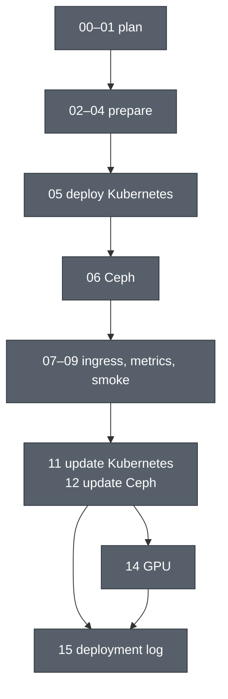

# kubernetes-lab

Build a production-like Kubernetes cluster from scratch for hands-on learning, covering high availability, networking, storage, security, and cluster administration.

## Teaching note

A production cluster is more than one control plane. You want three control planes, a floating API address, and a way in that is not the API itself. This lab teaches that shape with kubeadm, a gateway pair, a separate API load balancer, and Ceph on its own VMs. The limit is real: one KVM host. If that host dies, every VM dies. Three Ceph disks also share one SSD, so a disk failure is not a real Ceph failure test. Walk 02 → 09 on Debian 13 stacked first.

## Scope

This repo documents cluster deployment on top of a set of already-provisioned VMs. **VM/host provisioning is out of scope** — bring your own VMs (manual install, Ansible, a cloud provider, or any other method), reachable over SSH with a base OS installed. The node count and roles you need are defined in this documentation.

## Layout

Tables are padded so the columns line up in a text editor and still render as tables. Each procedure step is one short note, then one command block, with a short comment on the command that does the work.

One numbered spine. Circle a profile × scenario in [01-inventory.md](01-inventory.md) and one distro (Debian 13 or Ubuntu 26), then walk 02 → 09. The only branch is inside [05-deploy-kubernetes.md](05-deploy-kubernetes.md) (stacked or external bootstrap). Upgrades are 11, then 12, after the smoke test. GPU adds [14-gpu.md](14-gpu.md) after a healthy stacked or external cluster. Application databases are [apps/](apps/README.md) and stay blocked until that cluster is healthy. Site WAN/LAN addresses stay out of this repo — tables use example LAN IPs.

| Doc                                                | Covers                                                               |
| -------------------------------------------------- | -------------------------------------------------------------------- |
| [00-overview.md](00-overview.md)                   | Scope, profiles, scenarios, version pins                             |
| [01-inventory.md](01-inventory.md)                 | VM tables and the LAN plan, including the API load-balancer pair     |
| [02-prepare.md](02-prepare.md)                     | Prerequisites and OS baseline                                        |
| [03-firewall.md](03-firewall.md)                   | Gateway keepalived pair                                              |
| [04-bastion.md](04-bastion.md)                     | Docker Compose: Nexus, Prometheus, Grafana                           |
| [05-deploy-kubernetes.md](05-deploy-kubernetes.md) | containerd, API pair, bootstrap, join, Calico, kubectl, k9s          |
| [06-ceph.md](06-ceph.md)                           | Ceph deploy                                                          |
| [07-ingress.md](07-ingress.md)                     | Traefik, published on the API pair                                   |
| [08-observability.md](08-observability.md)         | node_exporter                                                        |
| [09-smoke-test.md](09-smoke-test.md)               | Smoke and stress                                                     |
| [10-security.md](10-security.md)                   | Hardening outline                                                    |
| [11-update-kubernetes.md](11-update-kubernetes.md) | Kubernetes, Calico, and external-etcd upgrades                       |
| [12-update-ceph.md](12-update-ceph.md)             | Ceph upgrade                                                         |
| [13-troubleshooting.md](13-troubleshooting.md)     | Notes filled in as a run hits them                                   |
| [14-gpu.md](14-gpu.md)                             | GPU profile only                                                     |
| [15-deployment-log.md](15-deployment-log.md)       | What was actually pinned, per run                                    |
| [apps/README.md](apps/README.md)                   | Application databases, after the cluster is healthy                  |

Same palette as everywhere else — see the [color legend](00-overview.md#diagram-color-legend).

## Deployment profiles

Four scenarios on one KVM host (24 threads, 128 GB RAM, three SSDs), never at the same time (they reuse the same IP plan) — see [00-overview.md](00-overview.md#deployment-profiles). The host itself is not redundant: [01-inventory.md](01-inventory.md#kvm-host). Pick the matching VM table in that file. The 32 GB machine is not a deploy target.

| Scenario                | VMs | Guest RAM                                             |
| ----------------------- | --- | ----------------------------------------------------- |
| **Stacked**             | 14  | 40 vCPU, 118 GB (92% of the host). Deploy this first. |
| **Stacked + GPU**       | 15  | 42 vCPU, 118 GB. [14-gpu.md](14-gpu.md).              |
| **External etcd**       | 16  | 40 vCPU, 122 GB.                                      |
| **External etcd + GPU** | 17  | 42 vCPU, 126 GB. 2 GB stays with the host.            |

Each row is under 128 GB. They are not added together. vCPU, disk, and the per-VM sizes are in [01-inventory.md](01-inventory.md#vm-resources).

## Rollout plan

1. **Stacked — current task.** On **Debian 13 first**, walk 02 → 09, then [11-update-kubernetes.md](11-update-kubernetes.md), then [12-update-ceph.md](12-update-ceph.md). Ubuntu 26 is the same path later, not at the same time.
2. **External etcd** — same spine, the other bootstrap section in [05-deploy-kubernetes.md](05-deploy-kubernetes.md), after the stacked cluster has been removed.
3. **Applications** — [apps/](apps/README.md), MariaDB Galera and PostgreSQL. Not part of the cluster bring-up. Open that directory only after step 1 has passed the smoke test.

Record the exact pinned component versions used on each run in [15-deployment-log.md](15-deployment-log.md).

## Scenarios

Two control-plane/etcd topologies — trade-offs in [00-overview.md](00-overview.md#scenarios):

- **Stacked etcd:** 3 control-plane nodes, etcd co-located on each. Bootstrap section in [05-deploy-kubernetes.md](05-deploy-kubernetes.md).
- **External etcd:** 2 control-plane nodes + 3 dedicated etcd nodes. The other bootstrap section in the same file.

## Status

02–09, 11, and 12 have runnable procedure (commands, configs, pinned-version installs). [10-security.md](10-security.md) and [13-troubleshooting.md](13-troubleshooting.md) stay outlines until a real run fills them in. [14-gpu.md](14-gpu.md) is an outline pending the first GPU run. [apps/](apps/README.md) is a blocked placeholder for MariaDB Galera and PostgreSQL. Versions marked "verify current" are not promises — check them against upstream before running.
